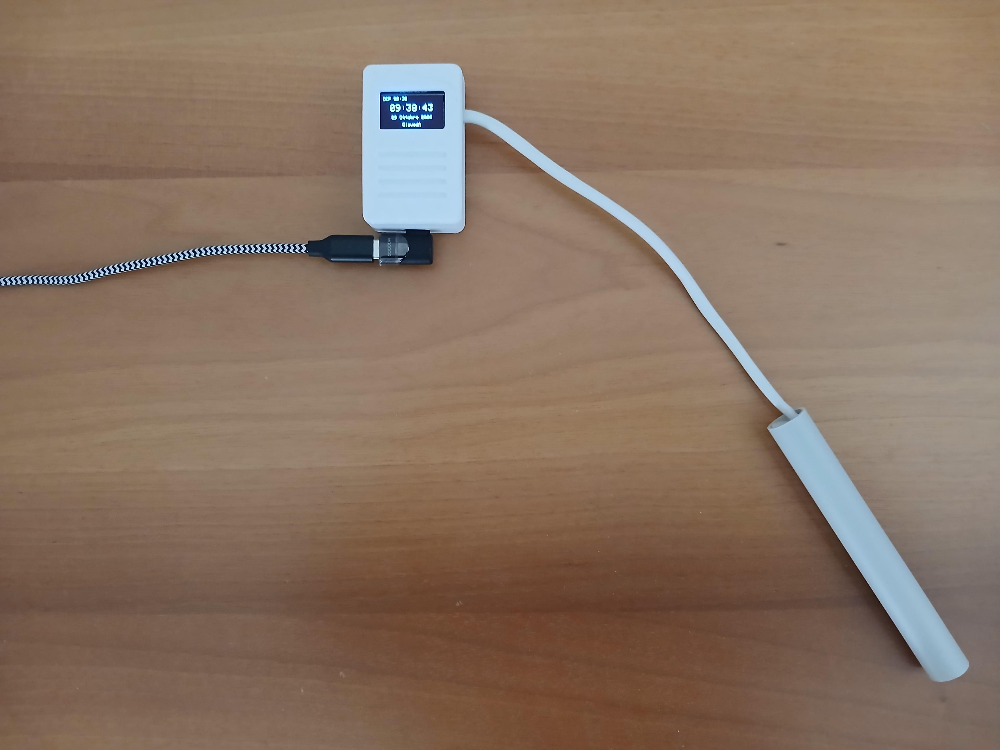
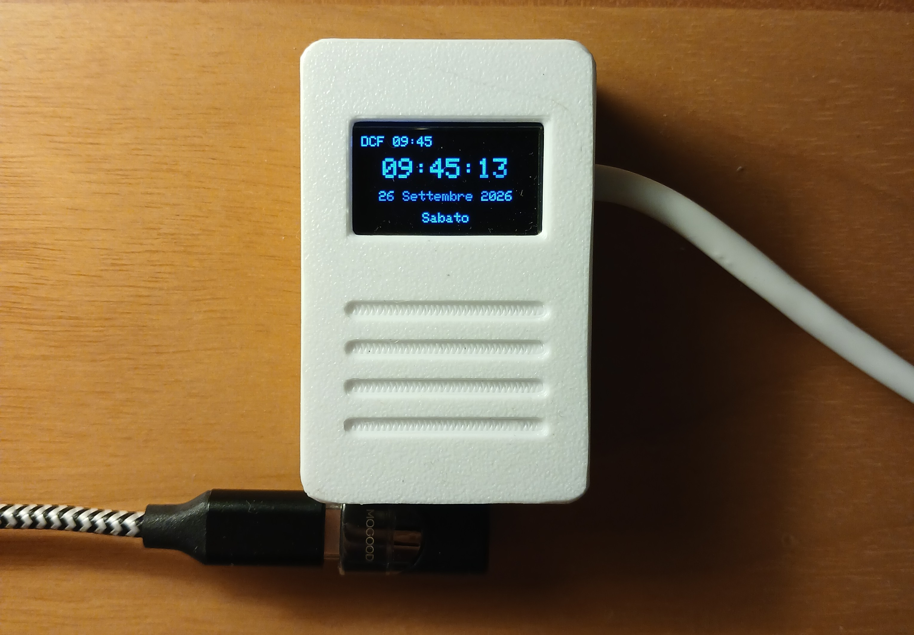
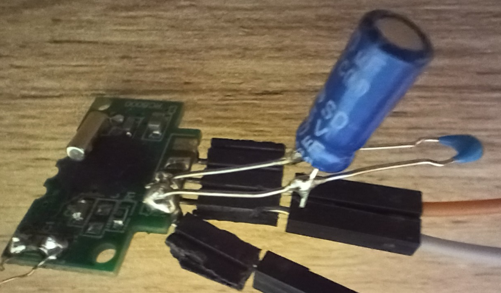
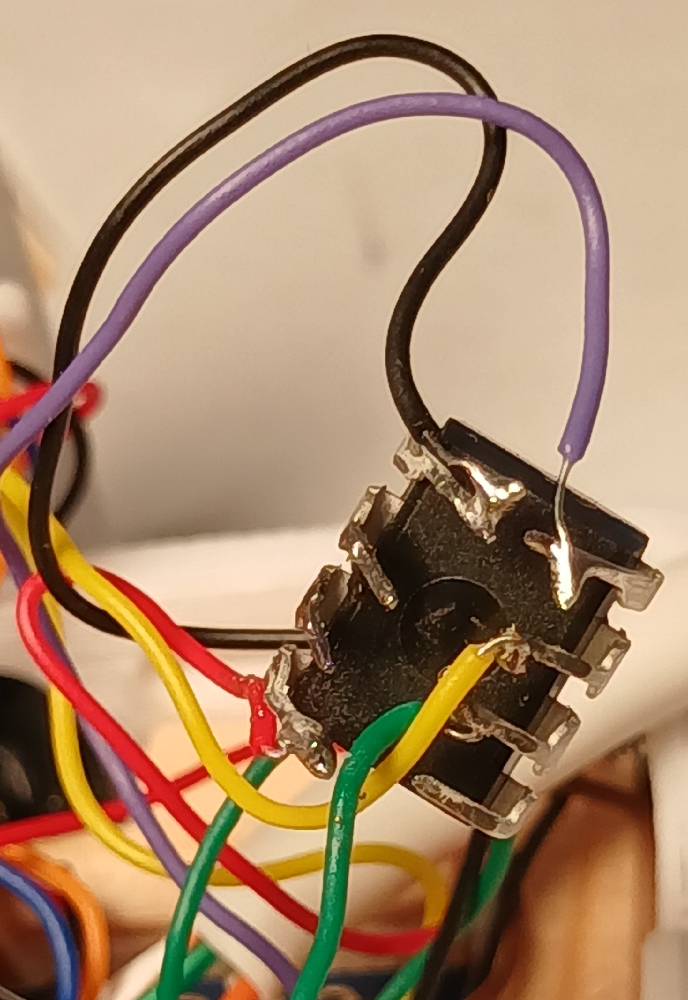
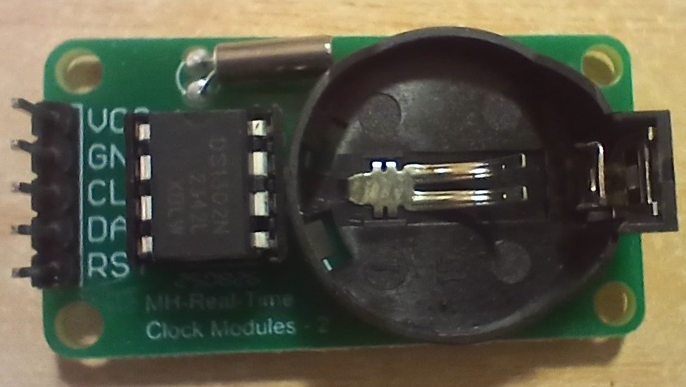
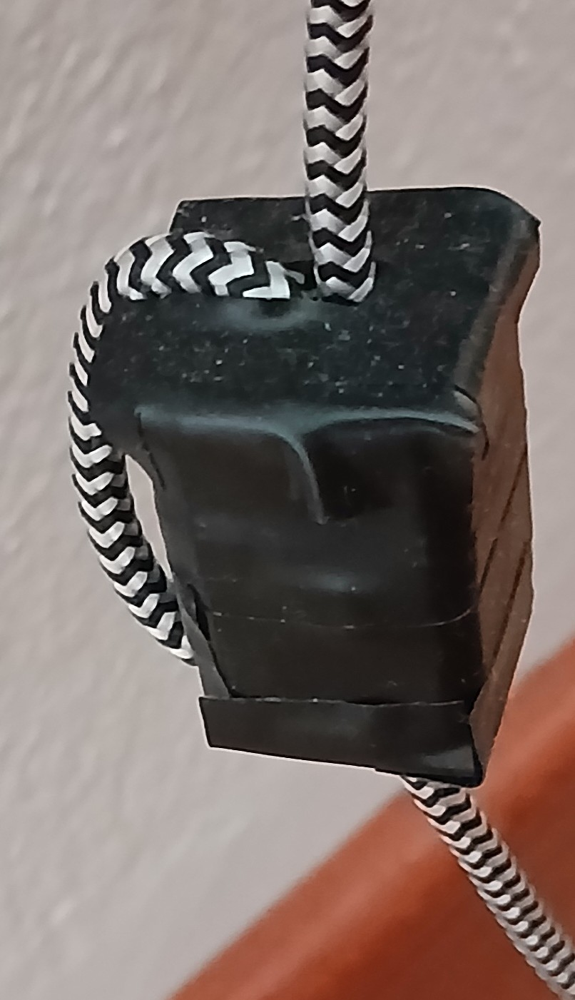
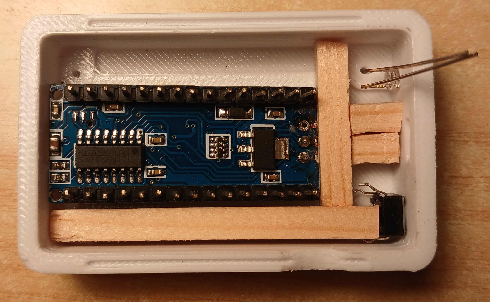
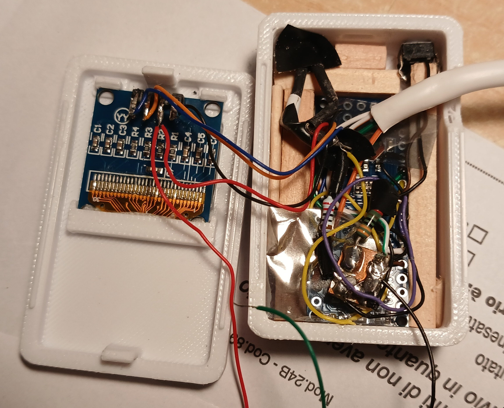
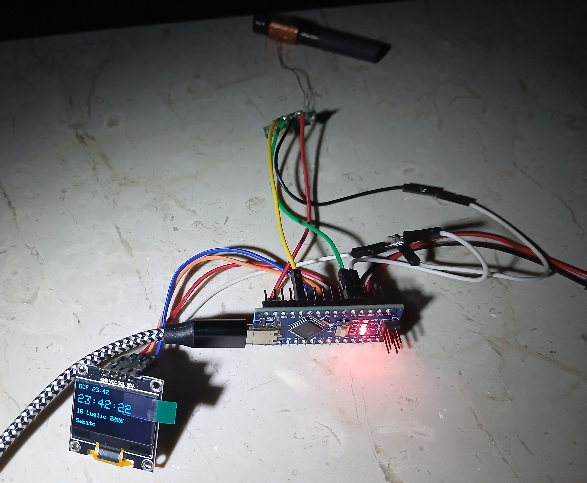

## DCF77-arduino-nano
# Ricevitore DCF77 completo per Arduino nano #





### Componenti:
  - Arduino nano
  - Modulo ricevitore DCF77 RC8000
  - Schermo OLED da 0.96 pollici SSD1306

  - (*opzionale*) led per visualizzare la ricezione del segnale + resistenza da 220 ohm per il led
  - (*opzionale*) bottone per abilitare/disabilitare il led

  - filtro anti-disturbo da applicare all'entrata del modulo RC8000
    - 100 nF ceramico multistrato
    - 10 µF elettrolitico
    
    
```
Arduino Nano
(3.3V) ------+-----------------+--------> VCC (RC8000)
             |                 |
            [+]               ---  100 nF (Ceramico Multistrato)
       10 µF (Elettrolitico)  ---  (Filtra disturbi ad alta freq.)
            [-]                |
             |                 |
(GND) -------+-----------------+--------> GND (RC8000)
  ```


  - (*opzionale ma consigliato*) RTC per mantenere l'ora corretta quando non è ricevuto il segnale di DCF77, in quanto il clock interno dell'Arduino nano perde normalmente circa 6 secondi ogni 15 minuti.
  
    - integrato RTC DS1302
    - quarzo da 32768
<pre style="font-family: monospace; white-space: pre; overflow-x: auto;">
DS1302 visto dall'alto, con la tacca in alto:

                             TACCA
                          +----+----+
              Pin 8 — VCC1│         │ Pin 1 — VCC2 => 5V Arduino
Arduino D4 <= Pin 7 — CLK │         │ Pin 2 — X1 --+
                          │ DS1302  │              | Quarzo 32,768 kHz
Arduino D5 <= Pin 6 — DAT │         │ Pin 3 — X2 --+  
Arduino D6 <= Pin 5 — RST │         │ Pin 4 — GND => Arduino GND
                          +---------+
</pre>



Esistono anche dei moduli RTC completi basati sul DC1302 che prevedono anche una batteria tampone che però non ho utilizzato perché occupano troppo spazio nella piccola scatola che ho scelto di utilizzare.



  - (*opzionale*) resistenza da 330 ohm per aumentare la corrente assorbita da utilizzare caso in cui si alimenti il tutto con un power bank (che si spengono automaticamente quando il carico è troppo basso).

Nel codice è presente una sezione di configurazioni in modo da cambiare il comportamento e disabilitare/abilitare RTC, resistenza, led, ecc.

### Collegamenti con Arduino nano

#### Modulo DCF77 
  - GND => GND Arduino
  - VCC => +3.3 V Arduino
  - OUT => D2 Arduino
  - PON => D8 Arduino

#### Schermo OLED

  - GND => GND Arduino
  - SDA => A4 Arduino
  - SCL => A5 Arduino
  - VCC => 5V Arduino

#### Bottone (opzionale)
  - GND
  - D9 Arduino

#### Led (opzionale)
  - GND
  - Resistenza 220 ohm => D3 Arduino

#### RTC (opzionale ma consigliato)
  - CLK (pin 7) => D4 Arduino
  - DAT (pin 6) => D5 Arduino
  - RST (pin 5) => D6 Arduino 
  
  - VCC (pin 1) => 5V Arduino

  - X1 (pin 2) => piedino quarzo
  - X2 (pin 3) => piedino quarzo

  - GND (pin 4) => GND Arduino
                                       
#### Resistenza di carico 330 ohm (opzionale)
  - GND
  - D7 Arduino

### Consigli e note

Se si alimenta l'Arduino nano con un alimentatore per evitare disturbi è consigliato mettere lungo il cavetto di alimentazione una ferrite.



Non mettere il modulo DCF77 vicino all'Arduino o allo schermo fanno interferenza, io ho messo il modulo con l'antenna ad almeno 10 cm di distanza dalla scatola con Arduino e OLED.

Io ho utilizzato un pezzo di tubo di plastica di quelli utilizzati per impianti elettrici  (sezione 6 mm) ed ho messo al suo interno il modulo RC8000 con applicato il filtro anti-disturbo e l'antenna in ferrite (come da immagine), in modo da tenere sia l'antenna in ferrite che il modulo di ricezione lontani dalla scatola contenente lo schermo e l'Arduino.

**La scatola**

Io ho comprato il progetto di stampa 3D di questa scatola (costa pochi euro):

[Universal ESP32/Arduino nano holder with display OLED 0.96"](https://cults3d.com/en/3d-model/gadget/universal-esp32-arduino-nano-holder-with-display-oled-0-96)

Per il led ed il bottone che sono opzionali ho praticato due buchi nella scatola, ed ho praticato un foro di uscita per i cavi di collegamento del modulo di ricezione del segnale di DCF77.

La scatola è piccola ed è molto precisa quindi ho scelto di utilizzare per i collegamenti interni dei fili piuttosto piccoli da 30AWG (diametro del conduttore circa 0,25 mm).

Per centrare esattamente l'uscita USBC dell'Arduino con il foro della scatola ho messo sotto l'Arduino un piccolo spessore di gomma e fissato ai lati l'Arduino con degli spessori in legno.




### Librerie esterne da installare
Per compilare e utilizzare correttamente il progetto è necessario installare alcune librerie aggiuntive tramite Arduino IDE.

- **Adafruit GFX Library** – Adafruit  
  Libreria grafica di base per la gestione del display OLED.  
  https://github.com/adafruit/Adafruit-GFX-Library

- **Adafruit SSD1306** – Adafruit  
  Gestione del display OLED SSD1306 tramite interfaccia I²C.  
  https://github.com/adafruit/Adafruit_SSD1306

- **Adafruit BusIO** – Adafruit
  Necessaria per alcune funzionalità di comunicazione hardware.
  https://github.com/adafruit/Adafruit_BusIO
  
- **TimeLib (Time)** – Paul Stoffregen  
  Gestione di ora, minuti, secondi, data e calendario.  
  https://github.com/PaulStoffregen/Time

- **Rtc by Makuna** – Makuna (opzionale, solo se si usa l'RTC: nel codice direttiva `RTC_ON`) 
  Gestione del modulo RTC DS1302.  
  https://github.com/Makuna/Rtc





